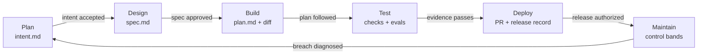

# AI 原生 SDLC 实践指南

## 便携产品规划

Plan 可先于代码仓库或 worktree 运行。当前契约在调用方指定目录产出 intent.md、prd.md、prototypes.md 和 delivery-plan.md，统一明确评审记录在 review.json。凭据绑定确切字节并追溯决定；调用方负责认证评审人，不由工具生成批准。

代码工作区就绪后，Design 前校验、导入需求包，按项目策略提交。下述仓库循环保持不变，设计和实施计划仍分别设门禁。无工作区 Plan 不声称 Git hook 强制执行。参见[便携产物契约](../plugins/ai-sdlc/references/portable-artifacts.md)。存储、通知、worktree、分支、派发和部署由调用方负责。历史仓库原生的已接受 intent 继续受支持。

## 核心理念

AI 生成代码的速度超过多数组织决定、审查和发布的速度。这不消除软件生命周期，而是将瓶颈从敲代码移到表达意图、落实策略、证明行为、决定风险和生产学习。

因此 AI 原生 SDLC 改变协作单元：不是聊天记录或 Agent 会话，而是真人与 Agent 都可读取的版本化产物。
每阶段读取上游已接受产物，产生自身证据，停在指定门禁。Agent 执行可规模化工作：归纳、检查、实现、验证、分诊和重复。真人保留判断：选择结果、澄清歧义、接受风险、批准发布及负责生产。

目标不是无人交付，而是让真人注意力花在决定上，不花在重建背景和机械检查上。
本仓库将 [Anthropic AI 原生 SDLC 实践指南](https://claude.com/blog/the-ai-native-sdlc-playbook)落实为具体产物契约。

## 循环



图示表达循环，不保证每项变更路线相同。低风险文档修正可从 Build 进入；生产异常可从 Maintain 进入并创建新 Plan 产物；高风险设计可能多次往返 Plan 与 Design。

从 Build 进入称为**快速路径**：真人声明低风险，Agent 对照 `REVIEW.md` 敏感路径清单检查，触及时拒绝；声明及结果记录于 `plan.md`。仅跳过阶段 1、2，仍需计划评审、实施、验证、阶段 5 审查及人工批准。门禁强制拒绝而非信任声明，阶段 5 再检查真实 diff，因为事前清单只是未完成工作的主张。

不变量是任何阶段不得代替下一门禁负责人编造接受决定。快速路径仅移除负责人无须判断的阶段，不削弱门禁。

`ai-sdlc` 的六个技能执行各阶段：`sdlc-plan`、`sdlc-design`、`sdlc-build`、`sdlc-test`、`sdlc-deploy`、`sdlc-maintain`。两个子 Agent 提供支持：`sdlc-reviewer` 负责阶段 3 计划评审、阶段 5 审查及发布前真实性复核；`sdlc-diagnostician` 负责阶段 6 越界诊断。本文描述方法，技能负责实际执行。

## 运行规则

1. 执行阶段工作前读取上游产物。
2. 每项变更保存在一个 `.sdlc/<slug>/` 目录。
3. 将状态视为数据，不是装饰。
4. 记录人工批准人和时间。
5. 不批准自己生成的产物。
6. 确定性策略放入 hook 或 CI，不只写在文字里。
7. 可重复使用的组织指导放入技能。
8. 附工具输出作为证据，不用“检查通过”替代。
9. 实施偏离计划时更新计划。
10. 逃逸缺陷和事件反馈到测试、eval 或指导。
11. 编码前评审计划，此时改方向只需改文字。
12. 限制审查轮次；反复不收敛说明方案有问题。
13. 从源头解决重复类别，防止第三次发生。
14. 审查评审者自身：其策略也是配置，逃逸缺陷就是 eval 来源。

## 文件位置

每项变更产物集中保存：

```text
.sdlc/<slug>/
├── intent.md
├── spec.md
├── plan.md
└── review-findings.md
```

`review-findings.md` 是跨轮次审查记忆，记录当前轮次、各轮 SHA、已发布发现、等待真人决定的已有缺陷及重复类别。没有它，评审者会每轮重读整个变更、重复上轮发现。

快速路径有 `plan.md` 和 `review-findings.md`，没有 intent 或 spec；plan 通过 `## Fast path` 记录低风险声明人和敏感路径检查结果。

保护评审者自身的 eval 每仓库一份，不按变更重复：

```text
.sdlc/evals/reviewer/
├── proposed/
├── confirmed/
└── clean/
```

`<slug>` 是稳定、简短、小写、连字符分隔的变更标识，不得复用于无关变更。
仓库级运行文件放在根目录：

```text
CLAUDE.md
REVIEW.md
bands.yaml
```

`CLAUDE.md` 为会话提供统一命令、架构、约定和重复纠正。`REVIEW.md` 定义审查项、严重程度阈值、排除项和证据标准。`bands.yaml` 定义确定性生产信号及各响应级别允许的最大动作。

若 Jira、ServiceNow、Figma 等仍是正式记录系统，每项 Markdown 必须指出记录，外部记录须包含提交 SHA 或 PR 链接。每个事实只有一个权威来源，两个系统持有工作副本时必须双向关联。

## 阶段 1：Plan 需求规划

### 用途

Plan 在问题被工单、会议和交接稀释前捕获它，记录当前做不到什么、期望可观测结果、影响对象及不可改变的边界。
它是初步规格，描述结果，不过早选择实现。
想法可来自真人、客户报告、事件、工单、定期扫描或控制带越界，均使用相同产物结构，让 Design 获得稳定输入。

### Agent 职责

用易懂语言访谈提出者，询问受影响用户、当前与期望行为、约束、排除项、证据和未决问题。
对“更好”“更快”“安全”等含糊成功标准追问，直到获得可观测描述。
起草并指出矛盾，不决定想法是否值得做。

### 真人职责

提出者纠正误解；产品负责人检查问题真实、结果有价值、范围一致。
约束需解释时咨询策略负责人。产品负责人接受或拒绝 intent。

### 契约产物：`.sdlc/<slug>/intent.md`

严格使用以下模板：

```markdown
# Intent: [feature name]
Author: [name]. Status: draft.

<!-- State the customer or operator problem, not the implementation. Keep this under a page. -->
## Problem
[what customers cannot do today]

<!-- Describe the observable result and success condition. -->
## Proposed outcome
[what better looks like]

<!-- Name people, services, data stores, APIs, and operational systems affected. -->
## Affected users and systems
[who and what is impacted]

<!-- Include hard limits: compatibility, privacy, cost, reliability, and rollout requirements. -->
## Constraints
[limitations or requirements]

<!-- List only unresolved decisions that require a human answer. -->
## Open questions
[unresolved items]
```

### 门禁条件

只有产品负责人在经评审提交中将 `Status` 改为 accepted 才放行。
产物须明确受影响用户、可观测结果、实质约束和未决问题。
接受后开始 Design；拒绝则关闭变更，保留历史。

### 防范的失败模式

防止用看似合理的实现替代缺失问题陈述；也防止意图经多次人工交接不断改写，最终工程接收到的已不同于提出者本意。

### 证据与有用信号

Git 记录首次提交、修订、作者和接受提交。衡量最早聊天或工单到 intent 提交时间、进入 Design 的接受比例，以及首次 spec 后的修改；后期修改可能说明捕获薄弱，也可能是真实新发现。

## 阶段 2：Design 技术设计

### 用途

将已接受 intent 转为需求和可实施系统设计，在调整仍便宜时落实最新品牌、安全、合规、无障碍、架构及用户体验策略。
需求与设计放在一起，减少转译损失。
Spec 说明系统必须做什么、保留哪些质量、如何适配现有系统，以及未解决疑虑。

### Agent 职责

阅读已接受 intent 和相关仓库背景，加载适用组织技能并列出标准。
提出新架构前检查当前架构。识别冲突、含糊需求、迁移风险、数据暴露和不可逆决定。
编写可转为测试或 eval 的验收条件，不默默替冲突策略做选择。

### 真人职责

产品负责人确认 spec 仍解决已接受问题；技术负责人确认可行性和系统适配。
指定策略负责人解决冲突。
高风险变更批准前，架构、安全、隐私或合规负责人参与。
产品负责人记录最终批准。

### 契约产物：`.sdlc/<slug>/spec.md`

严格使用以下模板：

```markdown
# Specification: [feature name]

<!-- Derive this specification from an accepted intent.md. This is the design-stage contract. -->
## Requirements

- [Observable functional requirement and acceptance condition]
- [Compatibility, performance, and failure-mode requirement]

## Design

<!-- Define interfaces, data flow, states, validation, and rollout behavior. -->
[design decisions]

## Organization skill constraints

<!-- Security, compliance, and data skills constrain this design; name the applicable rules. -->
- Security: [authentication, authorization, secrets, threat controls]
- Compliance: [privacy, retention, audit, accessibility, or regulation]
- Data: [classification, ownership, lifecycle, quality]

## Flagged concerns

<!-- Surface unresolved security, compliance, or data concerns for human disposition. -->
- [concern, impact, and owner]

## Extension contract

<!-- Mark an extension explicitly: host contract, version, inputs, outputs, failures, and compatibility. -->
- Extension: [none, or named extension contract]
```

### 门禁条件

阻塞问题已解决、需求可测试、策略冲突有明确决定责任人，且产品负责人在经评审提交中记录批准，才可放行。
高风险还需指定技术或策略负责人批准。
批准后进入 Build 的只读计划模式。

### 防范的失败模式

防止代码和测试已体现错误决定后，才在最终审查发现策略。
防止 Agent 将含糊结果直接转成大型 diff，也防止下游工程师从同一 intent 推导不同需求。

### 证据与有用信号

Git 记录 intent、spec 提交、标准版本、评审人和批准。
衡量 intent 接受到 spec 批准的耗时，以及首次构建计划提交后的 spec 提交数。
后期返工分类为新发现、需求遗漏或策略冲突。

## 阶段 3：Build 构建实现

### 用途

编辑仓库前选择具体实施路径。书面计划使文件范围、顺序、风险、证明方式和可并行工作对评审者可见。
先规划，让架构评审发生在只需修改 Markdown、不必撤回代码的时候。因此计划在工程师查看前，由 `REVIEW.md` 指定评审者审查。轮次规则与阶段 5 一致，三轮仍不收敛就重新考虑方案。
此时发现缺陷只需改一段；阶段 5 才发现则需提交、审查和复审。作者是 Agent 时，人几秒能回复的评论也可能变成完整循环。
批准后，Agent 实施满足 spec 的最小完整变更。

### Agent 职责

先读 intent、spec、`CLAUDE.md` 和相关代码。规划期间不修改源码。
列出每个预期新增或修改文件、顺序、迁移步骤、风险、证明命令和可能偏差。
影响可逆性或风险时解释未采用方案。
批准后实施、逐步测试；现实改变路径时更新计划。

### 真人职责

工程师质询计划：哪里会坏、哪步风险最大、哪些假设未验证、为何放弃其他方案。
确认其他工程师无需聊天记录也能执行。
批准计划并评估后续偏差。

### 契约产物：`.sdlc/<slug>/plan.md`

严格使用以下模板：

```markdown
# Plan: [feature name] (from intent.md [date])

<!-- Write this only after the intent and specification are accepted. Commit it before source-code writes. -->
## Files that change
[list of affected files]

## Order of work
[numbered steps]

## Risks
[potential issues]

## Proof
[test coverage description]

## Deviations
<!-- Record accepted departures from this plan as they occur; leave `None.` when there are none. -->
None.
```

### 门禁条件

工程师记录批准，且计划覆盖文件、顺序、风险和证明，才可放行。
计划仍为 Draft 时不实施。
实质偏离记录于 `Deviations`，合并前评审。

### 防范的失败模式

防止设计决定只存在私有会话或个人脑中；防止首个可审查对象已是架构调整昂贵的完整 diff；通过明确文件限制意外范围扩张。

### 证据与有用信号

计划批准提交记录选定路径和负责人。
衡量首次实现即合并占比、计划批准到合并时间、返工循环，以及最终 diff 是否匹配计划。
不靠隐藏计划变化优化首次通过率。

## 阶段 4：Test 测试验证

### 用途

真人审查前，为实施会话提供快速、确定性反馈，并回归验证引导 Agent 的配置。
代码测试回答产品行为是否正确；Agent eval 回答 `CLAUDE.md`、技能、hook、提示词、工具或模型变化后是否保持预期行为。二者都应进入 CI。

### Agent 职责

按适用范围执行构建、测试、lint、类型、安全和视觉检查。
修缺陷时，先用测试复现并确认因预期原因失败。
修代码，不削弱已有证据。
记录原始命令结果，映射到计划 Proof。
事件或重复 Agent 错误暴露缺失案例时增加 eval。

### 真人职责

工程师提供稳定、非交互的验证命令。
代码负责人检查证据是否覆盖风险行为，不只追求绿色输出。
QA 和领域负责人为需要判断的 eval 定义验收量表。
团队负责失败检查，Agent 不得豁免。

### 契约产物：根目录 `CLAUDE.md`

严格使用以下模板：

```markdown
# [Service name]

## Commands
- Build: [command]
- Test: [command]
- Lint: [command]

## Conventions
[team-specific rules]

## Architecture
[system design notes]

## Things Claude gets wrong
<!-- Record recurring, repository-specific mistakes with the correct action and why it matters. Prefer testable rules, such as “use tenant-scoped queries; unscoped queries leak data.” -->
[common mistakes to avoid]
```

每个 eval 包含任务提示词、预期结果、确定性评分器或明确量表、fixture 版本，以及事件 ID 等来源。

### 门禁条件

必需确定性检查通过、PR 附验证证据、Agent 配置变化达到 eval 阈值，才放行。
修复期间修改测试需评审者明确关注，或由修复模式 hook 阻止。
不稳定检查通过经评审流程隔离，不能默默重跑到绿。

### 防范的失败模式

防止代码生成加速后后期 QA 成为新瓶颈，防止 Agent 无工具证据就宣布成功，防止提示词、技能、hook、模型或工具变化悄然造成未来回归。

### 证据与有用信号

证据来自 CI 日志。衡量首次 CI 成功率、审查时间、变更失败率、eval 通过率、事件到 eval 时间，以及 CI 与生产捕获的回归。
只有套件包含真实、有区分力案例，高通过率才有意义。

## 阶段 5：Deploy 审查交付

### 用途

一致执行审查，保留职责分离，强制生产边界。
实施 Agent 可准备 PR、处理发现、组装发布材料、报告状态，不能自批 PR 或自行授权生产部署。
人工评审从平均阅读每行生成代码，转向判断意图、风险、证据和重要发现。

### Agent 职责

独立审查依据已接受 spec 和 plan 检查 Bugs、Security 和 Compliance。
按审查项和严重程度标记，引用精确证据，避免重复 lint 输出。

发布前复核发现：第二位只读评审者在独立上下文查看发现和被引用代码，不接触推理，回答失败是否真实，只判断真实性，不判断重要性。
轮次有上限并记录；第 1 轮后仅看新 diff，不重复已发布发现，多处同类缺陷只报告一次；达到上限即返回计划。

不是本次引入的真实缺陷以 Pre-existing 报告，不阻塞合并、不计入作者责任，但必须列出供真人决定。已有安全缺陷保留真实严重程度，照常阻塞。
同类问题出现于两项变更后，退出前必须固化到 `CLAUDE.md`、lint 或 `REVIEW.md`。修实例不等于修类别。

实施 Agent 可处理评论并通过同样检查推送修复。
发布 Agent 准备部署和回滚命令，不获取长期生产凭据。

### 真人职责

代码负责人判断是否符合 intent、残余风险是否可接受。
发布授权人决定是否及何时部署生产。
策略负责人评审本领域问题。
Agent 生成的发现、评分或无发现结果，都不等于人工批准。

### 契约产物：根目录 `REVIEW.md`

Anthropic 指南固定四章：`Passes`、`What Important means here`、`Cap the nits`、`Do not report`。
本实现增加六章，保证审查收敛和可执行：`Reviewer`、`Depth`、`Sensitive paths`、`Rounds`、`Verifier`、`Fix a repeat at its source`。保留全部十个名称，各项目调整章内内容。

插件在 `plugins/ai-sdlc/templates/REVIEW.md` 提供完整示例，由 `ai-sdlc-init` 复制到根目录。以此为唯一权威副本，不另抄一份导致过时。
四章涉及必须由项目明确作出、不能盲目继承的决定：

- `Reviewer`：指定阶段 3、5 的评审者及未安装时回退；回退始终是另行评审，不是跳过。
- `Depth`：决定审查强度，Security 不随深度削减。
- `Sensitive paths`：机器可检查的不可低风险清单，含 `REVIEW.md` 自身，防止快速路径清空。
- `Rounds`：上限和收敛规则；首轮后仅增量、不重复发现、同类缺陷只报一次。

PR、检查记录、审查发现、修复、批准、发布授权和部署日志共同构成 Deploy 产物。

### 门禁条件

分支保护要求检查通过及代码负责人批准。
生产 hook 要求具名、未过期、绑定被审查提交 SHA 的发布授权。
Agent 身份不能满足上述任一批准要求。
只为确切批准的提交和环境放行。

### 防范的失败模式

防止 Agent 规模化输出压垮非正式审查队列，防止时间压力下策略执行不一致，防止编写或修复代码的 Agent 自批或越过生产边界。

### 证据与有用信号

PR 和部署系统记录请求、发现、修复、批准、发布授权和部署时间。
衡量首次审查时间、无需真人改分支的评论解决率、合并前与逃逸缺陷、门禁等待和进入生产的违规。

## 阶段 6：Maintain 运维反馈

### 用途

将生产证据转为结构化新 intent，闭合循环。
检测保持确定性；只有版本化规则确认越界后才调用 Agent。
允许响应按级别扩大：记录、只读诊断、沿批准途径提出建议。
生产信号不授予无限生产权限。

### Agent 职责

诊断级别读取指标、日志、近期部署和仓库历史，说明证据、置信度、可能原因和缺失信息。
建议级别仅在配置明确允许时，创建 PR 或调用预批准 runbook。
为重新进入生命周期的工作编写 `.sdlc/<slug>/intent.md`。
不改阈值、不删除告警、不自行扩大响应权限。

### 真人职责

服务负责人选择监控信号，批准基线和响应级别。
值班工程师按立即修复、排期、说明理由后驳回进行分诊。
事件期间，事件指挥者保留权限。
恢复后团队将事件转为回归测试或 eval。

### 契约产物：根目录 `bands.yaml`

控制带是统计机制，不是固定告警阈值。指南结构包含指标、滚动基线、判断越界的规则集，以及按偏离基线标准差逐级升级的响应：

```yaml
metric: [metric_name]
baseline: rolling_30d
rules: western_electric
tiers:
  1sigma: { action: log }
  2sigma: { action: diagnose, tools: "[tool list]" }
  3sigma: { action: propose, routes: [pull_request, runbook:X] }
```

关键在升级：一倍标准差仅记录；两倍标准差调用 Agent 诊断，使用该控制带明确的工具允许清单；三倍标准差允许经真人控制的 PR 或具名 runbook 提出修复。没有任何级别自行部署。

公开 API 的完整示例：

```yaml
# Replace worked baselines with this service's approved SLOs.
bands:
  - metric: public_api_p99_latency_ms
    owner: api-platform
    baseline: rolling_30d
    rules: western_electric
    window: 10m
    tiers:
      1sigma: { action: log, tools: [dashboard-read] }
      2sigma:
        action: diagnose
        tools: [dashboard-read, logs-read, traces-read, git-log-read]
      3sigma:
        action: propose
        tools: [dashboard-read, logs-read, traces-read, git-log-read, deploy-history-read]
        routes: [pull_request, runbook:api-latency]

  - metric: public_api_error_rate_percent
    owner: api-platform
    baseline: rolling_30d
    rules: western_electric
    window: 5m
    tiers:
      1sigma: { action: log, tools: [dashboard-read] }
      2sigma: { action: diagnose, tools: [dashboard-read, logs-read, traces-read] }
      3sigma:
        action: propose
        tools: [dashboard-read, logs-read, traces-read, deploy-history-read]
        routes: [pull_request, runbook:api-errors]

  - metric: checkout_conversion_rate
    owner: growth
    baseline: rolling_30d
    rules: western_electric
    window: 1h
    tiers:
      1sigma: { action: log, tools: [analytics-read] }
      2sigma: { action: diagnose, tools: [analytics-read, logs-read, git-log-read] }
      3sigma:
        action: propose
        tools: [analytics-read, logs-read, git-log-read, deploy-history-read]
        routes: [pull_request, runbook:checkout-regression]
```

没有稳定基线的指标（如新服务或硬性合同 SLO）可合理简化为绝对阈值。使用时通过注释说明，避免把固定告警误认作统计控制带。
每份工具列表都是允许清单，每项都必须只读；授予写工具就已不再只是监控。

### 门禁条件

检测器必须不依赖模型即可复现越界。
配置级别必须允许请求动作。
只读诊断可在沙箱自动运行。
源码变更必须经 PR。
生产动作仅使用预批准 runbook，并走正常生产授权。

### 防范的失败模式

防止告警、工单和复盘行动无限等待真人重启开发；防止概率性诊断自行成为触发器；防止生产监控转成 Agent 的长期生产权限。

### 证据与有用信号

检测日志记录指标、基线、规则、级别、越界时间、调用、输出和分诊决定。
衡量越界到 intent 时间、转为合并修复的发现，以及同类重复事件。

## 产物链

```text
Problem, idea, ticket, or incident
        |
        v
.sdlc/<slug>/intent.md
        |  product owner accepts
        v
.sdlc/<slug>/spec.md
        |  product owner approves; specialist joins for risk
        v
.sdlc/<slug>/plan.md
        |  engineer approves before edits
        v
code diff + tests + verification evidence
        |  deterministic checks pass
        v
pull request + REVIEW.md findings
        |  code owner and release authority approve
        v
production deployment + operational signals
        |  bands.yaml detects a breach
        v
incident record or next .sdlc/<new-slug>/intent.md
```

每个箭头既是触发器，也是责任边界。箭头下的产物可自动生成，旁边标出的批准不能自动推定。
完整产物链回答六个审计问题：

1. 谁提出变更，为什么？
2. 哪些需求和策略影响了它？
3. 实施前批准了哪条路径？
4. 哪些证据证明它有效？
5. 谁接受残余风险并批准发布？
6. 生产给下一轮带来什么经验？

## 指南扩展：确定性持续生效机制

原博客将 hook 用作护栏，未将其作为循环持续生效机制。循环需要在各阶段边界重新声明约束，不能假设 Agent 记得当前产物、适用技能或待确认人工门禁。
仅靠记忆时，并行请求可能切换任务；注意力转移、边界不再重申，循环就悄然失效。
四个独立层次防止衰退：`PreToolUse` 强制门禁，`SessionStart` 恢复阶段上下文，`UserPromptSubmit` 在有工作时说明阶段和门禁，初始化的 `CLAUDE.md` 标记块提供持久记忆。共同抵御上下文重置与并发会话造成的遗忘。

## 与传统 SDLC 的区别

传统流程将文档作为专业团队交接包；本模型用小型、持续更新的产物作为人与 Agent 间的可执行上下文。
传统需求常经多层解释；这里提出者原意成为首项版本化产物，由产品负责人纠正归纳。
传统策略往往后期检查；这里生成 spec 时加载现行策略，编码前升级冲突。
传统实施计划可能直到完成 diff 才公开；这里调整成本低时就评审计划。
传统 QA 位于下游；这里每次实现都有本地反馈，CI 同时测试代码和 Agent 配置。
传统评审依赖个人注意力和记忆；这里确定性检查去除机械噪声，`REVIEW.md` 保证一致，真人聚焦意图和实质风险。
传统治理常是文档加定期审计；这里技能在工作时提供策略，hook 和分支规则执行硬边界，Git 保存变更与批准。
传统维护等待真人发现、分诊、重启；这里确定性控制带触发有界诊断，将新 intent 写回同一受治理循环。
Agent 做更多工作不意味着控制更弱；控制应更早、更可重复、更可见，并更紧密绑定动作。

## 健康循环的定义

无需读取私人聊天即可检查流程。每项活动变更有唯一 slug 及完整上游链；每次状态转换注明有权作决定的真人或确定性检查；每个成功主张指向工具证据。
生产权限按环境、动作、身份和时间限定。每个逃逸失败都应成为代码、测试、eval、技能、hook、评审策略或控制带的持久改进。
只有产物链可理解，速度才有价值；只有团队能解释自动化可以做什么、什么阻止它、证据在哪里及谁负责，自动化才成熟。
